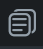

## 6.4 Initial Page

Predvolene je ako úvodná stránka zvolená tá, ktorú ti FlutterFlow vytvoril pri vytvorení projektu.
Ak chceš ako úvodnú stránku (initial page) zvoliť inú stránku. Budeš potrebovať editovať nasledujúce nastavenie:

1. Z ľavého menu zvoliť `Settings & Integrations`
2. V sekcii `General` zvoliť záložku `App Details`
3. A v sekcii `Initial Page` zvoliť `Entry Page` podľa vlastného výberu

> Pripomenutie: Ak si už mal svoju aplikáciu otvorenú v testovacom móde, zvoľ v ňom možnosť `Hot Reload` pre
> refreshnutie aplikácie

Samozrejme ako `Initial Page` vieš zvoliť naozaj len stránku (ikona: ), ktorú sme si
vytvárali v lekcii [6.1-Pages.md](6.1-Pages.md).

Spomenutá konfigurácia je zobrazená aj v nasledujúcom obrázku:

[6.4-Initial-Page.md](6.4-Initial-Page.md)