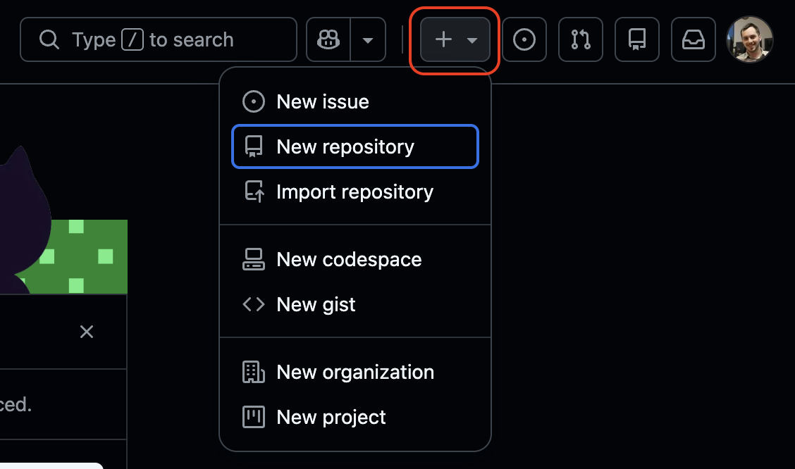
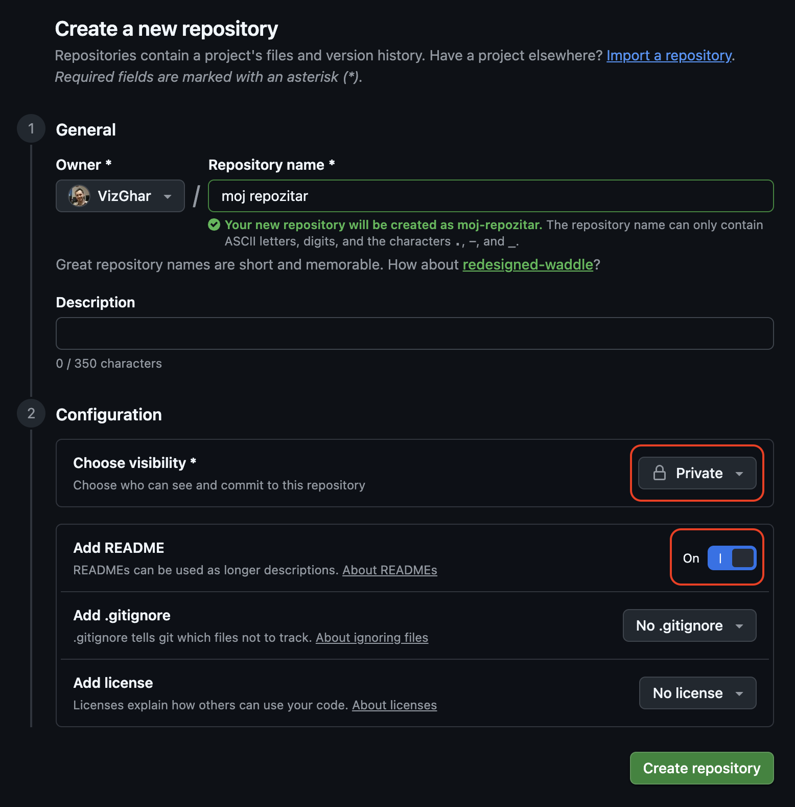
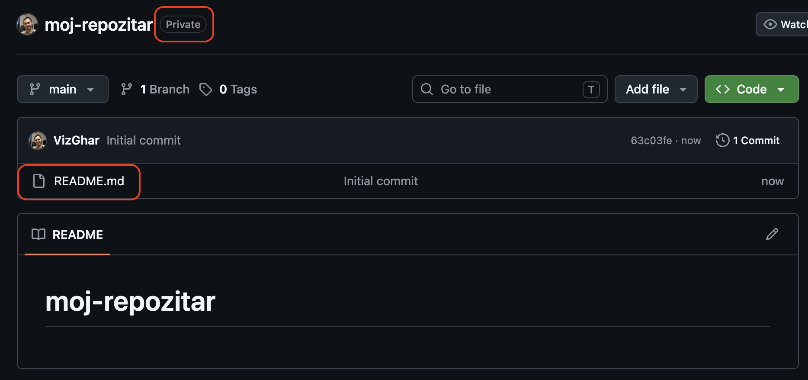
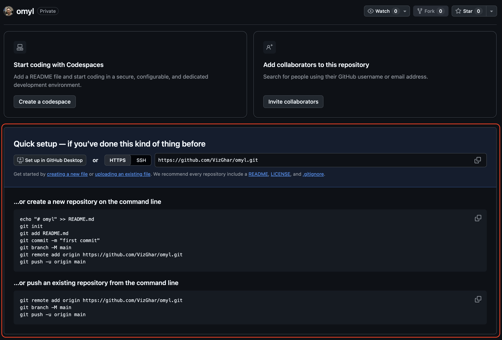

# GitHub a privátny repozitár

Keď sa ti podarilo spojazdniť SSH komunikáciu s GitHub-om, tak si už GitHub dokáže overiť tvoju totožnosť. Vďaka nej ti
dovolí pristupovať
1. K tvojim osobným repozitárom pre čítanie
2. K tvojim osobným repozitárom pre editáciu
3. K iným repozitárom, podľa role, ktorú si na tomto repozitári dostal

V každom prípade si GitHub overí tvoju identitu skôr, ako vykonáš nejakú akciu. Aby sme si boli istí, že všetko funguje
ako má, môžeme si vytvoriť vlastný **privátny repozitár**. K tomu nebude mať prístup nikto, len jeho vlastník (a ten,
koho vlastník do projektu pozve)

## Vytvorenie privátneho repozitára

Pre vytvorenie privátneho repozitára:
1. prihlás sa do github.com 
2. zvoľ možnosť New Repository pod tlačidlom <kbd>+</kbd> v hornej lište (obrázok 1)
3. repozitár pomenuj, visibility nastav na `private` a vytvor aj `README` súbor (obrázok 2)

Ak si splnil kroky správne, tak by si mal v detaile repozitára vidieť označenie `private` aj `README`
súbor, ako je to na nasledujúcom obrázku:

Ak namiesto `README` súboru uvidíš "Quick Setup" návod, tak si zabudol zvoliť možnosť vytvorenia `README`
súboru a repozitár je zatiaľ úplne prázdny:

To vieš ošetriť zvolením možnosti `creating new file` alebo rovno kliknutím a slovíčko `README` v časti
Quick Setup