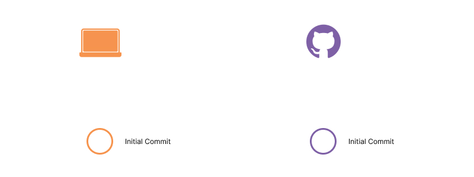
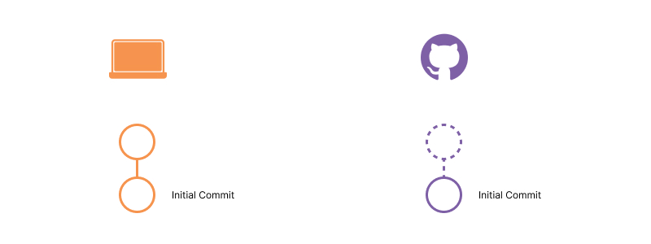
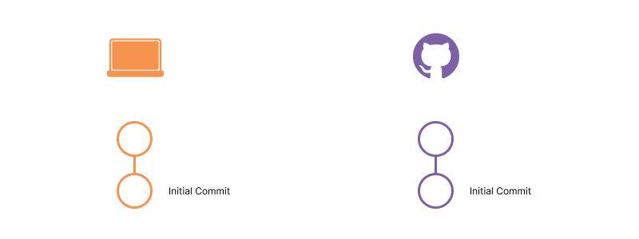
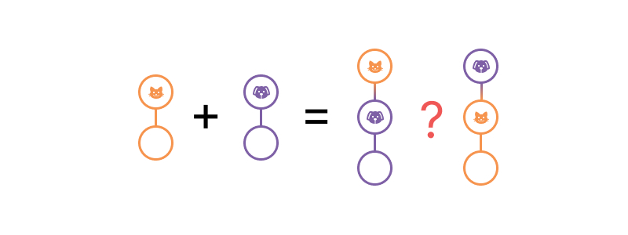

# 14.2 Git push

Prešli sme si troma kľúčovými témami:
1. [Privátny repozitár na GitHube](14.1-GitHub-privatny-repozitar.md) máme úspešne vytvorený
2. [SSH komunikáciu](../13-SSH-spojenie-s-GitHubom/13.1-SSH-komunikacia.md) pre overovanie identity a GitHube máme nastavenú
3. Repozitár si vieme dotiahnuť do nášho počítača pomocou príkazu [git clone](../12-Git-ako-distribuovany-system/12.2-git-clone.md)

Preto môžeme na GitHube začať robiť operácie, ktoré vyžadujú overenie našej identity. Bez SSH komunikácie by mi totiž mohol
ktokoľvek prepísať dáta v mojom repozitári.

Keď vytvoríme repozitár na GitHube a naklonujeme ho, tak je GitHub repozitár totožný s lokálnym:



Bežný use-case (hlavne pre vás) bude:
1. Vytvorenie a naklonovanie repozitára
2. Úprava lokálneho repozitára (napríklad vytvorenie novej obrazovky na vašej webstránke)
3. Nahratie zmien z lokálneho repozitára na GitHub

Ak vytvoríš jednu, alebo viac, nových verzií (bod 2), tak tvoj lokálny repozitár bude o krok pred GitHubom:



Teraz bude nutné na GitHub nahrať naše zmeny (bod 3). To spravíme pomocou príkazu

```shell
git push
```

Ak GitHub bude jednoznačne vedieť prilepiť nové commity do svojho repozitára, tak to spraví, a naše repozitáre budú opäť
rovnaké:



> **Pozor!** Medzi lokálnym a vzdialeným repozitárom môže nastať nesúlad a `git push` môže zlyhať. V tomto prípade bude
> nutné lokálne upraviť poradie/obsah commitov aby sme tento súlad obnovili.



Úpravu poradia commitov vieme zabezpečiť pomocou interaktívneho rebase ([pick](../09-Interaktivny-rebase-pick-a-reword/9.1-git-rebase-interactive-pick.md)
alebo [drop](../09-Interaktivny-rebase-pick-a-reword/9.3-git-rebase-interactive-drop.md) argumenty), prípadne použitím príkazu `git reset`.