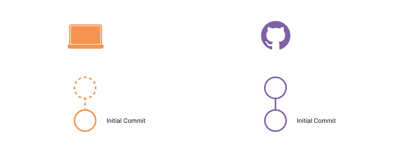

# 15.1 Git pull

Tak, ako sme sa dostali v zmenou lokálneho repozitára do nesúladu s GitHubom, tak sa vieme do tohto nesúladu dostať aj tým,
že zmena sa udeje na GitHube. Teda náš lokálny repozitár bude pozadu:



To sa môže stať napríklad vtedy, ak robíš na dvoch počítačoch, alebo ak na projekte pracujete viacerí. Jednoducho niekto
na GitHub nahrá nový commit, ktorý ty zatiaľ nemáš u seba.

V tomto prípade vieš tieto commity ku sebe natiahnuť použitím príkazu

```shell
git pull
```

> **Dôležité:** Tak isto, ako to bolo v prípade `git push`, aj v prípade `git pull` sa môžeme dostať do stavu, kedy bude
> remote a local repozitár v nesúlade. Riešenie je opäť interaktívny rebase, alebo `git reset`.