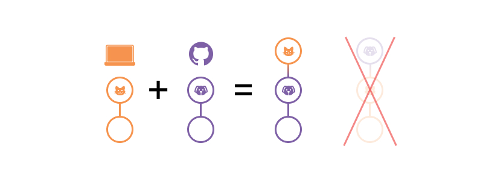

# 15.2 Git pull a push - dodatky

## Úplný príkaz `git pull` a `git push`

Úplné príkazy pre `git pull` a `git push` vyzerá nasledovne:

```shell
git push REMOTE BRANCH
git pull REMOTE BRANCH
```

Kde:
- `REMOTE` je názov remote-u, obvykle `origin` (pozri výstup príkazu `git remote -v`)
- `BRANCH` je názov vetvy, do ktorej chceš zmeny nahrať. V 99% prípadov je to vetva, na ktorej sa práve nachádzaš (pozri výstup príkazu `git status` alebo `git branch`)

## `git pull --rebase`

Tento príznak dokáže ošetriť počas `git pull` nesúlad medzi **remote** a **local** repozitárom tak, že **lokálne** commity rebasne
na **remote** commity. To samozrejme len v prípade, ak nevznikne navyše konflikt (konflity si budeme vysvetľovať neskôr).

Takže jeden z príkazov:
```shell
git pull --rebase
git pull --rebase origin main
```

Zjednodušene vykoná:



## Danger zone - `push -f`

Veľmi zriedka používame aj takzvaný force push. Ktorý prepíše históriu na remote. Nebezpečné je to hlavne kvôli tomu, že
táto operácia môže mať dopad aj na ostatných kolegov a je ťažko revertovateľná. Klasické prípady použitia:

- v malej firme / sólo projekte **po pushnutí** zistíš, že potrebuješ volať `git commit --amend`
- pracuješ na vlastnej (nie `main`/`master`/`develop`) branchi, na ktorú máš dosah len ty a chceš niečo zmeniť
- junior spraví nejaký prúser v gite a opravuješ to po ňom


Force push vykonáme volaním jedého z príkazov:

```shell
git push -f
git push -f origin main
```