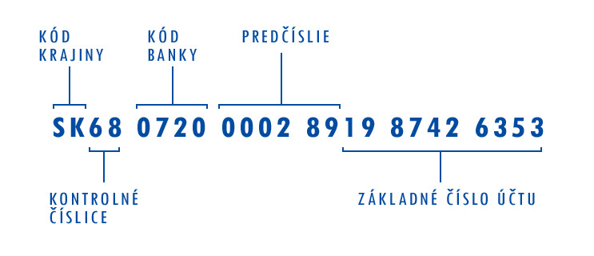
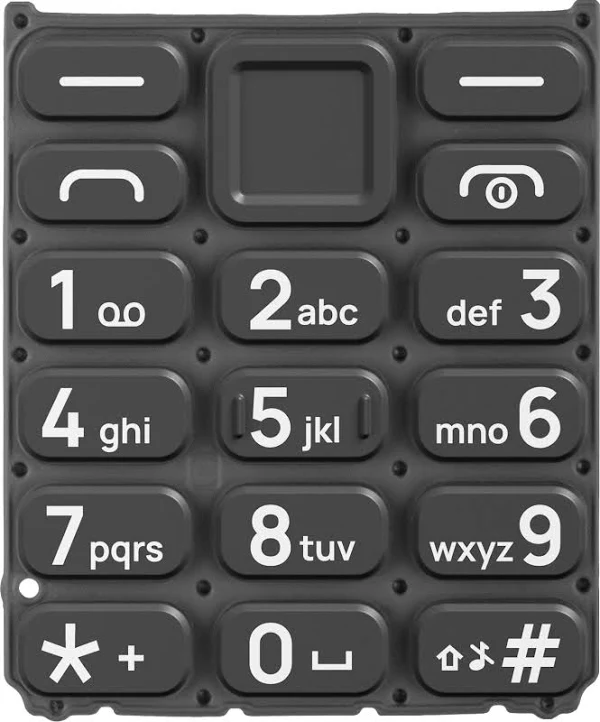

# Úlohy – blok 1

## 1. Rozcvička – druhé mocniny

Na štandardnom vstupe načítajte celé číslo `N` a následne `N` celých čísel. Pre každé z načítaných čísel na štandardnom výstupe vypíšte jeho druhú mocninu.

`N` je z intervalu ⟨0, 1000⟩.

| Ukážka vstupu                | Ukážka výstupu             |
| ---------------------------- | -------------------------- |
| `3`<br>`56`<br>`112`<br>`13` | `3136`<br>`12544`<br>`169` |
| `0`                          |                            |
| `1`<br>`1`                   | `1`                        |

## 2. Benford’s law

Benfordov zákon slúži na rýchle odhadnutie podvodných bankových účtov (ale aj iných číselných údajov). Bežný používateľ bankového účtu totiž uskutočňuje transakcie rôznej hodnoty. Benfordov zákon prekvapivo dobre dokáže odhadnúť podvodnosť účtov kontrolovaním prvej číslice transakcií. Transakcií, ktoré začínajú jednotkou, je napríklad vo všeobecnosti oveľa viac ako transakcií začínajúcich deviatkou.

Na štandardnom vstupe načítajte celé číslo `N`. Následne `N`-krát načítajte hodnotu transakcie. Na štandardnom výstupe vypíšte, koľko z týchto transakcií sa začínalo číslom `5` a koľko je to percent z celkového počtu. Výsledné percento môžete a nemusíte zaokrúhliť.

| Ukážka vstupu                                                                                                                                                             | Ukážka výstupu |
| ------------------------------------------------------------------------------------------------------------------------------------------------------------------------- | -------------- |
| `6`<br>`512`<br>`128`<br>`5.23`<br>`4.10`<br>`51.18`<br>`1.12`                                                                                                            | `3 50%`        |
| `15`<br>`4.5`<br>`1.123`<br>`54.33`<br>`12.55`<br>`102.44`<br>`43.23`<br>`119.23`<br>`554.12`<br>`999.99`<br>`89.12`<br>`43.55`<br>`5.15`<br>`5.22`<br>`183.43`<br>`1990` | `4 26.67%`     |

## 3. LURDy

Klasickým problémom pri programovaní top-bottom počítačových hier je určovanie pozície panáčikov na nekonečnej hracej doske. Viete zistiť, kde sa bude panáčik nachádzať po vykonaní série krokov na takejto nekonečnej mriežke?

Majme postavičku vloženú do nekonečnej 2D mriežky na súradnici `[0, 0]`. Súradnice zapisujeme v poradí `[x, y]`. Bod `[0, 0]` zodpovedá ľavému hornému rohu obrazovky: `x` rastie smerom doprava a `y` smerom dole. Mriežka je nekonečná, takže pri pohybe doľava alebo hore môžu byť súradnice aj záporné.

Každý krok posunie postavičku o jedno políčko: `L` zníži `x` o `1`, `R` zvýši `x` o `1`, `U` zníži `y` o `1` a `D` zvýši `y` o `1`.

Zo štandardného vstupu v cykle načítavajte znaky Left, Right, Up, Down (každý znak sa bude nachádzať na samostatnom riadku). Na základe načítaného znaku posuňte figúrku na tejto mriežke doľava (`L`), doprava (`R`), hore (`U`) alebo dole (`D`). Ak načítate iný znak ako dané štyri, ukončite cyklus a vypíšte, kde sa vaša figúrka nachádza.

| Ukážka vstupu                                                             | Ukážka výstupu |
| ------------------------------------------------------------------------- | -------------- |
| `L`<br>`L`<br>`R`<br>`D`<br>`D`<br>`L`<br>`L`<br>`L`<br>`U`<br>`D`<br>`y` | `-4 2`         |

## 4. Konečný priestor

Klasickým problémom pri programovaní top-bottom počítačových hier je určovanie pozície panáčikov na konečnej hracej doske. Viete zistiť, kde sa bude panáčik nachádzať po vykonaní série krokov na takejto doske?

Majme postavičku vloženú do 2D mriežky veľkosti `10 × 10` na súradnici `[1, 1]`. Súradnice zapisujeme v poradí `[x, y]`, pričom obe sú v rozsahu `0–9`. Bod `[0, 0]` je ľavé horné políčko mriežky: `x` rastie smerom doprava a `y` smerom dole. Pravé dolné políčko má súradnice `[9, 9]`.

Každý krok posunie postavičku o jedno políčko: `L` zníži `x` o `1`, `R` zvýši `x` o `1`, `U` zníži `y` o `1` a `D` zvýši `y` o `1`.

Zo štandardného vstupu v cykle načítavajte znaky Left, Right, Up, Down (každý znak sa bude nachádzať na samostatnom riadku). Na základe načítaného znaku posuňte figúrku na tejto mriežke doľava (`L`), doprava (`R`), hore (`U`) alebo dole (`D`). Ak načítate iný znak ako dané štyri, ukončite cyklus a vypíšte, kde sa vaša figúrka nachádza.

**Ak narazíte na kraj mapy, súradnicu panáčika nemeňte.**

| Ukážka vstupu                                                      | Ukážka výstupu |
| ------------------------------------------------------------------ | -------------- |
| `L`<br>`L`<br>`R`<br>`D`<br>`D`<br>`U`<br>`U`<br>`U`<br>`U`<br>`a` | `1 0`          |

## 5. IBAN

IBAN je identifikátor, v ktorom je zakomponovaný kód krajiny, kód banky, predčíslie aj číslo účtu. Na základe IBANu teda viete zistiť, ktorá banka spravuje daný účet.



*IBAN – [zdroj](https://www.finsider.sk/servis/iban-z-cisla-uctu/).*

Zo štandardného vstupu načítajte jeden text `iban`. `iban` bude vždy validné IBAN číslo účtu bez medzier. Ak sa čísla na pozíciách `4–8` rovnajú niektorému z nasledovných kľúčov, na štandardný výstup vypíšte priradenú hodnotu.

| Kód banky | Výstup       |
| --------- | ------------ |
| `7500`    | `CSOB`       |
| `8360`    | `mBank`      |
| `1100`    | `Tatra`      |
| `0200`    | `VUB`        |
| Inak      | `Neexistuje` |

| Ukážka vstupu              | Ukážka výstupu |
| -------------------------- | -------------- |
| `SK2283608635434443564684` | `mBank`        |
| `SK6624124848215914375643` | `Neexistuje`   |
| `SK5302009715144226138888` | `VUB`          |
| `SK7211005425141732612611` | `Tatra`        |

## 6. Vydavateľ karty

V každom čísle, ktoré používateľ bežne nemá dôvod čítať, je ukrytá nejaká zvláštna informácia. Napríklad sa zamyslime nad takým číslom bankovej (kreditnej/debetnej) karty. Bankové karty vyrábajú rôzni vydavatelia. Pre nás sú najznámejšie karty VISA a MasterCard. Avšak poznať by sme mohli aj AmericanExpress, Discover či Maestro. Prvých pár čísel nám vie presne povedať, kto danú kartu vyrobil.

*Obr. 1: VISA karty sú karty s číslom začínajúcim štvorkou.*

Zo štandardného vstupu načítajte číslo kreditnej/debetnej karty `cardNumber`.

- Ak sa toto číslo začína číslom `4`, ide o kartu **VISA**.
- Ak sa toto číslo začína `2221–2720` alebo `51–55`, ide o kartu **MasterCard**.

Na základe načítaného čísla vypíšte na štandardný výstup, kto danú bankovú kartu vydal. Ak to nie je ani VISA, ani MasterCard, potom na štandardný výstup vypíšte text `Neexistuje`.

| Ukážka vstupu      | Ukážka výstupu |
| ------------------ | -------------- |
| `4335415464763737` | `VISA`         |
| `371695677152017`  | `Neexistuje`   |
| `4335445411914984` | `VISA`         |
| `5320615333460712` | `MasterCard`   |

## 7. Čítanie rodného čísla

Na štandardnom vstupe načítajte `rodneCislo` ako text. Na štandardný výstup vypíšte rok, mesiac, deň narodenia a pohlavie osoby, ktorej rodné číslo patrí. Ak dané rodné číslo nie je v správnom formáte, vypíšte text `Neexistuje`.

**Kontrolujte výlučne prvých 6 znakov rodného čísla.**

Napríklad rodné číslo vo formáte `900309/xxxx` znamená, že osoba sa narodila v roku 1990 (prvé dva znaky), v treťom mesiaci (druhé dvojčíslie) a v deviaty deň (tretie dvojčíslie).

Pre ženy sa k druhému dvojčísliu prirátava `50`, teda číslo `906209/xxxx` by patrilo žene narodenej v decembri.

| Ukážka vstupu | Ukážka výstupu     |
| ------------- | ------------------ |
| `900309/xxxx` | `9.3.1990 - muž`   |
| `906209/xxxx` | `9.12.1990 - žena` |
| `000101/xxxx` | `1.1.2000 - muž`   |
| `007200/xxxx` | `Neexistuje`       |

## 8. Validácia ISBN

Aj čiarové kódy často skrývajú nejakú dodatočnú informáciu o produkte. Už ste možno počuli, že prefix `858` na niektorých produktoch znamená, že výrobok bol vyrobený na Slovensku. Viete však, že čiarový kód na knihe je zároveň jej jednoznačným identifikátorom (tzv. ISBN)?

*Obr. 1: ISBN skrytý v čiarovom kóde knihy.*

ISBN 13 je formát, ktorý je pomerne jednoduché zvalidovať. Na štandardnom vstupe načítajte `isbn` ako text. Číslo musí mať dĺžku `13`, inak je nevalidné. Následne sčítajte všetky cifry v tomto `isbn`. Každú nepárnu cifru však ešte pred sčítaním vynásobte trojkou.

```text
1234567890123 => 1 + 2×3 + 3 + 4×3 + 5 + 6×3 + 7 + 8×3 + 9 + 0×3 + 1 + 2×3 + 3 = 95
```

Týmto súčtom dostanete číslo, ktoré po delení `10` vráti zvyšok `0`. Ak po delení `10` nedostanete zvyšok `0`, ISBN je nevalidné (skener čiarového kódu zle vyhodnotil tento kód).

Na štandardný výstup vypíšte `valid`, ak je ISBN validné, a `invalid`, ak je číslo nevalidné.

| Ukážka vstupu   | Ukážka výstupu |
| --------------- | -------------- |
| `1234567890123` | `invalid`      |
| `9785021010184` | `valid`        |
| `9788539381852` | `valid`        |
| `9788539481852` | `invalid`      |

## 9. Tlačidlový telefón

Trošku histórie… Kedysi neexistovali dotykové obrazovky a podstatne viac sa používali tlačidlové telefóny. Ak ste chceli napísať SMS, tak ste museli pracovať len s obmedzeným počtom kláves, preto pod jednou klávesou bývalo schovaných viac písmen. Ak ste na klávesnici na obrázku 1 chceli napísať text `ahoj`, museli ste stlačiť 1× dvojku, 2× štvorku, 3× šestku a 1× päťku.



*Obr. 1: Tlačidlá na tlačidlovom telefóne.*

Na štandardnom vstupe načítajte text, aké klávesy boli na klávesnici telefónu stlačené (napr. `2446665`). Na štandardný výstup vypíšte, aký text používateľ telefónu uvidí na obrazovke (`ahoj`).

**Aby bola táto úloha riešiteľná, používateľ nikdy nezadá dve písmená s rovnakým číslom.** Teda napr. výstupný text `ABC` nie je validný.

| Ukážka vstupu       | Ukážka výstupu |
| ------------------- | -------------- |
| `24466650526655666` | `ahoj janko`   |
| `55566688833`       | `love`         |
| `020220222`         | `a b c`        |

## 10. Koník

Šachový kôň sa pohybuje do tvaru písmena L: o dve políčka v jednom smere a o jedno políčko v kolmom smere. Z jedného políčka tak môže skočiť najviac na osem rôznych políčok. Pri okraji šachovnice je však možností menej.

Majme prázdnu šachovnicu veľkosti `8 × 8`. Súradnice zapisujeme v poradí `[x, y]`, pričom obe sú v rozsahu `0–7`. Bod `[0, 0]` je ľavé horné políčko: `x` rastie smerom doprava a `y` smerom dole. Pravé dolné políčko má súradnice `[7, 7]`.

Zo štandardného vstupu načítajte dve celé čísla `x` a `y`, každé na samostatnom riadku. Predstavujú aktuálnu polohu koňa a vždy budú v rozsahu `0–7`.

Na štandardný výstup vypíšte všetky políčka, na ktoré môže kôň skočiť **jedným ťahom bez opustenia šachovnice**. Každé políčko vypíšte na samostatnom riadku vo formáte `x y` (dve čísla oddelené medzerou).

**Výsledky zoraďte vzostupne podľa `x`. Pri rovnakom `x` ich zoraďte vzostupne podľa `y`.**

| Ukážka vstupu | Ukážka výstupu                                                       |
| ------------- | -------------------------------------------------------------------- |
| `0`<br>`0`    | `1 2`<br>`2 1`                                                       |
| `3`<br>`3`    | `1 2`<br>`1 4`<br>`2 1`<br>`2 5`<br>`4 1`<br>`4 5`<br>`5 2`<br>`5 4` |
| `7`<br>`7`    | `5 6`<br>`6 5`                                                       |
